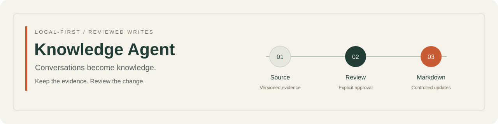
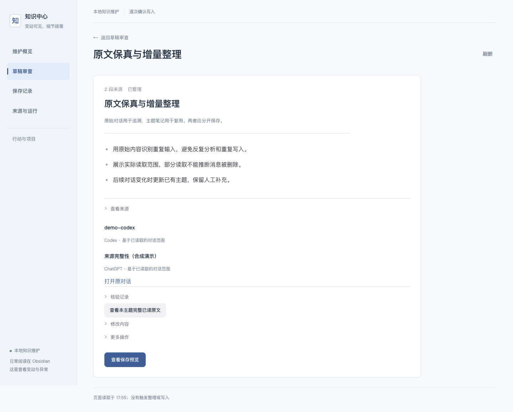

# Knowledge Agent
Turn everyday AI conversations into traceable, reviewable Markdown notes that can evolve with later discussions.



**Local-first · Explicit approval · Source traceability**

Personal prototype, developed with AI assistance. [中文](README.md) · [Architecture](docs/architecture.md) · [Verification](docs/verification.md)

## Try the isolated demo

Install Node.js 24+ and npm. Download and extract this repository, or clone it, then run from its directory:

```bash
npm ci --ignore-scripts
npm run demo:product
```

Open the `home` URL printed by the command. The current interface is in Chinese:

1. Open **草稿审查** (draft review), select **原文保真与增量整理**, and expand **查看来源** to inspect the source evidence.
2. Select **查看保存预览** (preview), check the confirmation box, and save.
3. Open **来源与运行 → 来源配置与手动读取** and select **演示：新增一段对话**. Review the update to the same note, save it, then try restoring it from **保存记录**.

The demo uses synthetic conversations and deterministic proposals. **No API keys, model calls, account access, or existing notes are required.** Writes stay in a fresh private temporary directory. Stop with `Ctrl+C`. Dependency installation needs network access; the running demo does not. `npm start` launches the same demo.



## Why this exists

A one-off summary is easy to copy. Maintaining it across later conversations is harder: which conclusion changed, what supports it, and how can an update preserve your own edits?

This project separates semantic proposals from execution. The assistant proposes content; code checks source versions, exact evidence, preview hashes and file state; the user approves each write. It is for personal workflows that need traceability and incremental maintenance. An ordinary chat summary is simpler for disposable notes.

## What is implemented

- Versioned conversation sources, with explicit partial-history boundaries.
- Incremental topics and stale-result rejection.
- Preview-bound writes, duplicate-save protection and controlled rollback.
- Preservation of manual content outside managed note sections.
- Persistent processing records and human-controlled action adoption.
- A local HTTP workbench backed by Node.js ES modules and private files.

```bash
npm test
```

Tests use isolated temporary stores and simulated providers. [Environment and evidence](docs/verification.md). Test counts are not semantic accuracy measurements.

## Status and limits

Runnable personal prototype. Real semantic extraction still requires assistant participation; the demo is synthetic. Long-term content quality, productivity gains, unattended operation and full ChatGPT history coverage are unproven. The service does not log into ChatGPT independently. Optional search is outside the default demo and was not revalidated in this release preparation.

Local verification uses macOS and Node 24. A Linux CI configuration is included; no hosted CI success is claimed before it runs. Windows is unverified. See [architecture](docs/architecture.md), [local usage](docs/local-use.md), [contributing](CONTRIBUTING.md) and [security](SECURITY.md).

Maintained by [tian415](https://github.com/tian415), with AI-assisted development. [ISC License](LICENSE).
